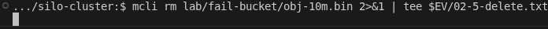
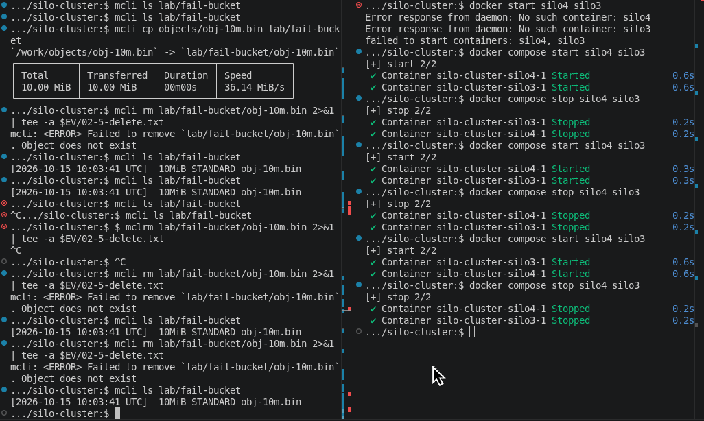
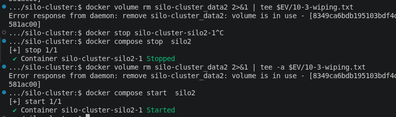

# Failure & Healing
## Goal
To testing out what could be happen if one or even all the node review. After that, test and review its node healing

## Environment
- Images : [Silo and NGINX as Load Balancer](../01-build-cluster/evidence/compose-ps.txt)
- Docker and Docker Compose versions : [Docker and Docker Compose Versions](../01-build-cluster/evidence/docker-version.txt)
- OS : [Nix and NixOS Version](../01-build-cluster/evidence/local-os-version.txt)
- Topology :
    - Profile C (more small machines, 4GB RAM and 8GB Swap): 4 nodes x 1 drive [Topology](../01-build-cluster/evidence/free-h.txt)
- Date : 11 Oct 2026
---
- Images : [Silo and NGINX as Load Balancer](../01-build-cluster/evidence/compose-ps.txt)
- Docker and Docker Compose versions : [Docker and Docker Compose Versions](../01-build-cluster/evidence/docker-version.txt)
- OS : [Nix and NixOS Version](../01-build-cluster/evidence/local-os-version.txt)
- Topology :
    - Profile C (more small machines, 4GB RAM and 8GB Swap): 4 nodes x 1 drive [Topology](../01-build-cluster/evidence/free-h.txt)
- Date : 15 Oct 2026


## Steps
### Prepare (bucket, checksum before, healthy baseline)
This step is to create initiate and make sure there's no error before we start failure test

0. Before Start

Before initiate anything, this documentation using `preused-cli/mcli.bash` before start everything. You may use these command in root of project to have same experiences

- Command
```bash
chmod +x preused-cli/mcli.bash
. preused-cli/mcli.bash
```
- Expected  : Having `mcli` that almost same as this documentation `mcli` used
- Evidence  : [./evidence/00-0-use-mcli.txt](./evidence/00-0-use-mcli.txt)
- Result    : PASS

1. Create a Bucket

Create new bucket to focusing on this failure healing task.

- Command
```bash
mcli mb lab/fail-bucket
```
- Expected  : `fail-bucket` created
- Evidence  : [./evidence/00-1-create-bucket.txt](./evidence/00-1-create-bucket.txt)
- Result    : PASS

2. Create an Object 

We will use `obj-10m.bin` that has been made before. If you haven't had it, you can use this following command

- Command
```bash
head -c 10M /dev/urandom > objects/obj-10m.bin
```
- Expected  : Object name `obj-10m.bin` created
- Evidence  : [../../objects/obj-10m.bin](../../objects/obj-10m.bin)
- Result    : PASS

3. Create a Checksum for Local Object
- Command
```bash
sha256sum objects/obj-10m.bin | tee docs/05-failure-healing/evidence/00-2-checksum-before.txt
```
- Expected  : Created checksum before for `obj-10m.bin` in local
- Evidence  : [./evidence/00-2-checksum-before.txt](./evidence/00-2-checksum-before.txt)
- Result    : PASS

4. Testing Upload Object
- Command
```bash
mcli cp --checksum SHA256 objects/obj-10m.bin lab/fail-bucket/obj-10m.bin
```
- Expected  : `obj-10m.bin` uploaded in `fail-bucket`
- Evidence  : [./evidence/00-3-uploaded-bucket.txt](./evidence/00-3-uploaded-bucket.txt)
- Result    : PASS

5. Verify Uploaded Object Condition
```bash
mcli checksum verify lab/fail-bucket/obj-10m.bin
```
- Expected  : Having match and verified condition object
- Evidence  : [./evidence/00-4-verify.txt](./evidence/00-4-verify.txt)
- Result    : PASS

6. Info Status
```bash
mcli admin info lab
```
- Expected  : 4 drives online
- Evidence  : [./evidence/00-5-info-healthy.txt](./evidence/00-5-info-healthy.txt)
- Result    : PASS

### Stop Node
For stopping node, you may use this command :
```bash
docker compose stop <node-name>
```
#### Stop 1 Node
1. Stop Node
- Command
```bash
docker compose stop silo4
```
- Expected  : `silo4` deactivate
- Evidence  : [./evidence/01-1-info-down.txt](./evidence/01-1-info-down.txt)
- Result    : PASS

2. Check Status
- Command
```bash
mcli admin info lab
```
- Expected  : 1 Node Offline
- Evidence  : [./evidence/01-1-info-down.txt](./evidence/01-1-info-down.txt)
- Result    : PASS

3. Upload Object
- Command
```bash
mcli cp objects/obj-10m.bin lab/fail-bucket/1-node-offline.bin
```
- Expected  : Object Successfully Uploaded
- Evidence  : [./evidence/01-2-create.txt](./evidence/01-2-create.txt)
- Result    : PASS

4. Download Object
- Command
```bash
mcli cp lab/fail-bucket/obj-10m.bin objects/1-node-offline.bin
sha256sum objects/1-node-offline.bin
```
- Expected  : Object Successfully Downloaded
- Evidence  : [./evidence/01-3-read.txt](./evidence/01-3-read.txt), [./evidence/01-4-sha.txt](./evidence/01-4-sha.txt)
- Result    : PASS

5. Listing Objects
- Command
```bash
mcli ls lab/fail-bucket
```
- Expected  : Successfully listing objects
- Evidence  : [./evidence/01-5-list.txt](./evidence/01-5-list.txt)
- Result    : PASS

6. Remove Object
- Command
```bash
mcli rm lab/fail-bucket/1-node-offline.bin 2>&1 | tee $EV/01-6-delete.txt
```
- Expected  : Successfully delete objects
- Evidence  : [./evidence/01-6-delete.txt](./evidence/01-6-delete.txt)
- Result    : PASS

7. Reactivate Node
- Command
```bash
docker compose start silo4 
mcli admin info lab
```
- Expected  : Successfully reactivate node
- Evidence  : [./evidence/01-7-info-recovered.txt](./evidence/01-7-info-recovered.txt)
- Result    : PASS

#### Stop 2 Nodes
1. Stop Node
- Command
```bash
docker compose stop silo4 silo3
mcli admin info lab
```
- Expected  : `silo4` and `silo3` deactivate
- Evidence  : [./evidence/02-1-info-down.txt](./evidence/02-1-info-down.txt)
- Result    : PASS

2. Upload Object
- Command
```bash
mcli cp objects/obj-10m.bin lab/fail-bucket/2-node-offline.bin
```
- Expected  : Can't Uploaded
- Evidence  : [./evidence/02-2-create.txt](./evidence/02-2-create.txt)
- Result    : PASS

3. Download Object
- Command
```bash
mcli cp lab/fail-bucket/obj-10m.bin objects/2-node-offline.bin
```
- Expected  : Object Successfully Downloaded
- Evidence  : [./evidence/02-3-read.txt](./evidence/02-3-read.txt)
- Result    : PASS

4. Listing Objects
- Command
```bash
mcli ls lab/fail-bucket
```
- Expected  : Successfully listing objects
- Evidence  : [./evidence/02-4-list.txt](./evidence/02-4-list.txt)
- Result    : PASS

5. Remove Object
- Command
```bash
mcli rm lab/fail-bucket/obj-10m.bin
```
- Expected  : Can't remove. Failed remove because object doesn't exist or won't give any responses
- Evidence  : [./evidence/02-5-delete.txt](./evidence/02-5-delete.txt), [./screenshots/02-05-delete.png](./screenshots/02-5-delete.png)
- Result    : PASS

6. Reactivate Node
- Command
```bash
docker compose start silo4 silo3
mcli admin info lab
```
- Expected  : Successfully reactivate node
- Evidence  : [./evidence/02-6-info-recovered.txt](./evidence/02-6-info-recovered.txt)
- Result    : PASS

7. List After Reactivate
- Command
```bash
mcli ls lab/fail-bucket
```
- Expected  : Continue deleting object
- Evidence  : [./screenshots/02-7-after-recovery.txt](./screenshots/02-7-after-recovery.txt)
- Result    : PASS for the first try but it doesn't continue deleting after that. All the results are good but this makes unpredicted response. I don't know the truth about it but here is the [detail](#finding)

#### Stop 3 Nodes (Extra)
>**NOTE** : Not required by the task. Only `silo1` stays online (1 of 4 drives). Write, update and delete are skipped because they already don't work with 2 nodes down. Only status, read, and list are tested. Commands use `timeout 60` because requests may hang without quorum.

1. Stop Nodes
- Command
```bash
docker compose stop silo2 silo3 silo4
docker compose ps
mcli admin info lab
```
- Expected  : `silo2`, `silo3`, and `silo4` offline. `admin info` may fail or show 3 nodes offline and 1 drive online
- Evidence  : [./evidence/03-1-info-down.txt](./evidence/03-1-info-down.txt)
- Result    : PASS

2. Download Object
- Command
```bash
timeout 60 bash -c '. preused-cli/mcli.bash; mcli cp lab/fail-bucket/obj-10m.bin objects/3-node-offline.bin'
```
- Expected  : Fails or hangs. Reading needs at least 2 of 4 drives and only 1 is online
- Evidence  : [./evidence/03-2-read.txt](./evidence/03-2-read.txt)
- Result    : PASS

3. Listing Objects
- Command
```bash
timeout 60 bash -c '. preused-cli/mcli.bash; mcli ls lab/fail-bucket'
```
- Expected  : Fails or hangs, same reason as reading
- Evidence  : [./evidence/03-3-list.txt](./evidence/03-3-list.txt)
- Result    : PASS

4. Reactivate Nodes
- Command
```bash
docker compose start silo2 silo3 silo4
docker compose ps
mcli admin info lab
```
- Expected  : All services `healthy`, 4 drives online
- Evidence  : [./evidence/03-4-info-recovered.txt](./evidence/03-4-info-recovered.txt)
- Result    : PASS/FAIL

5. Data After Recovery
- Command
```bash
mcli cp lab/fail-bucket/obj-10m.bin objects/3-node-recovered.bin
sha256sum objects/3-node-recovered.bin
cat docs/05-failure-healing/evidence/00-2-checksum-before.txt
```
- Expected  : Object readable again and both hashes are identical
- Evidence  : [./evidence/03-5-sha.txt](./evidence/03-5-sha.txt)
- Result    : PASS/FAIL

### Wipe 1 Drive and Healing
1. Start All Services
- Command
```bash
docker compose up -d
docker compose ps
```
- Expected  : All Services active
- Evidence  : [./evidence/10-1-start-services.txt](./evidence/10-1-start-services.txt)
- Result    : PASS

2. Data Before Wipe
- Command
```bash
mcli ls lab
docker compose exec silo2 sh -c 'ls -a /data'
```
- Expected  : All bucket still there
- Evidence  : [./evidence/10-2-data-before.txt](./evidence/10-2-data-before.txt)
- Result    : PASS

3. Wiping Drive
- Command
```bash
docker compose exec silo2 sh -c 'rm -rfv /data/*  /data/.[!.]*'
```
- Expected  : All deleted in `/data` silo2
- Evidence  : [./evidence/10-3-data-wiping.txt](./evidence/10-3-data-wiping.txt)
- Result    : PASS

>**NOTE** : You can't delete volume which service still used even after it's already stopped

4. Data After Wipe
- Command
```bash
docker compose exec silo2 sh -c 'ls -a /data'
docker compose exec silo2 sh -c 'ls -a /data/fail-bucket'
mcli ls lab
mcli checksum verify lab/fail-bucket/obj-10m.bin
```
- Expected  : All bucket still there and checksum still the same
- Evidence  : [./evidence/10-4-data-after.txt](./evidence/10-4-data-after.txt)
- Result    : PASS

6. Restart All Services
- Command
```bash
docker compose stop
docker compose start
docker compose ps
mcli admin info lab
```
- Expected  : All services `healthy`, 4 drives online
- Evidence  : [./evidence/11-1-restart-all.txt](./evidence/11-1-restart-all.txt)
- Result    : PASS

### Restart All and Checksum Comparison
1. Restart All Services
- Command
```bash
docker compose stop
docker compose start
docker compose ps
mcli admin info lab
```
- Expected  : All services `healthy`, 4 drives online
- Evidence  : [./evidence/11-1-restart-all.txt](./evidence/11-1-restart-all.txt)
- Result    : PASS

2. Compare Checksum
- Command
```bash
mcli cp lab/fail-bucket/obj-10m.bin objects/final.bin
sha256sum objects/final.bin
cat docs/05-failure-healing/evidence/00-2-checksum-before.txt
```
- Expected  : Both hashes are identical
- Evidence  : [./evidence/11-2-checksum-compare.txt](./evidence/11-2-checksum-compare.txt)
- Result    : PASS

3. Verify Stored Object
- Command
```bash
mcli checksum verify lab/fail-bucket/obj-10m.bin
mcli ls --recursive lab/fail-bucket
```
- Expected  : `1 verified, 1 match, 0 mismatch`, and no unexpected objects
- Evidence  : [./evidence/11-3-verify.txt](./evidence/11-3-verify.txt)
- Result    : PASS

## Finding
1. You won't get any response deleting object while stop 2 nodes. Screenshots Evidence :



2. There's interesting issue while test removing object with stop 2 nodes. Which is when we start it again, there might be chance to continue deleting. After that, every time I try to delete will give fail status because object doesn't exist but it's actually exist. Maybe it's either because i'm testing the command really fast or just device issue

- 
- [./evidence/02-5-delete.txt](./evidence/02-5-delete.txt)

3. You can't delete volume without stopping its services

- 

## How to Reproduce and Clean Up
Same as [Past Configuration](../02-healthcheck/readme.md#how-to-reproduce-and-clean-up)